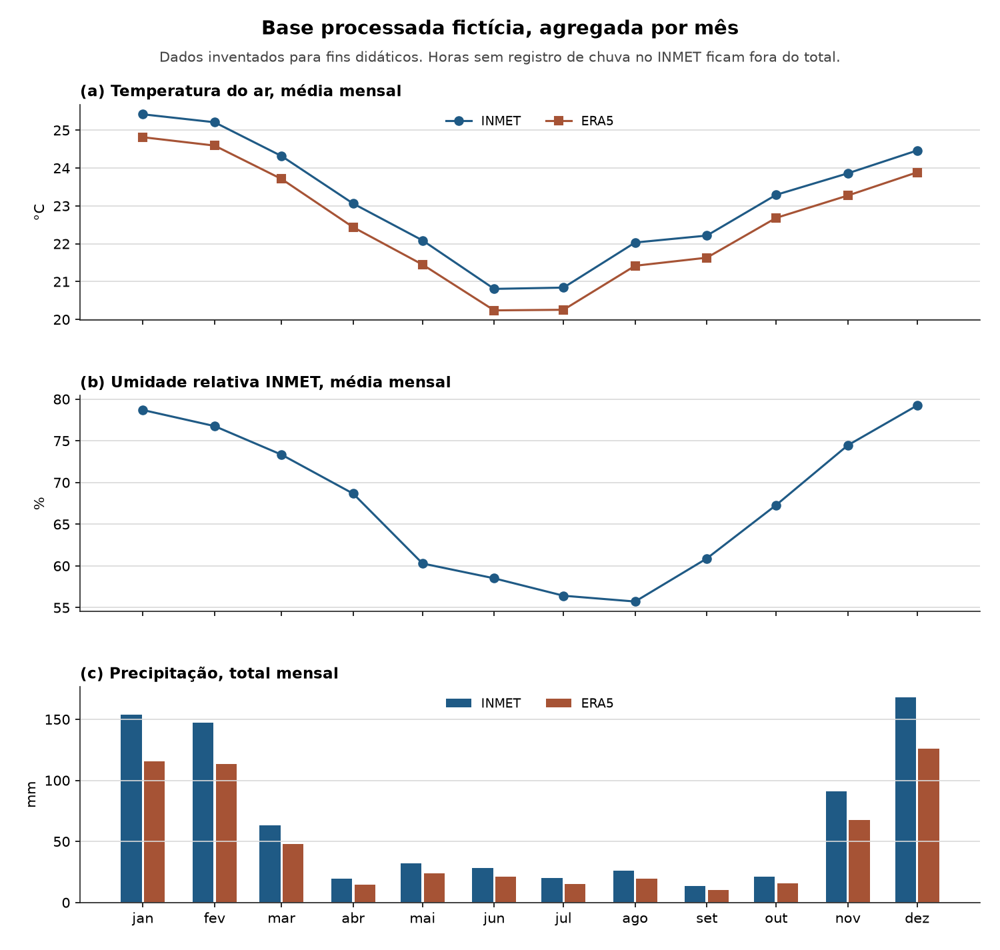
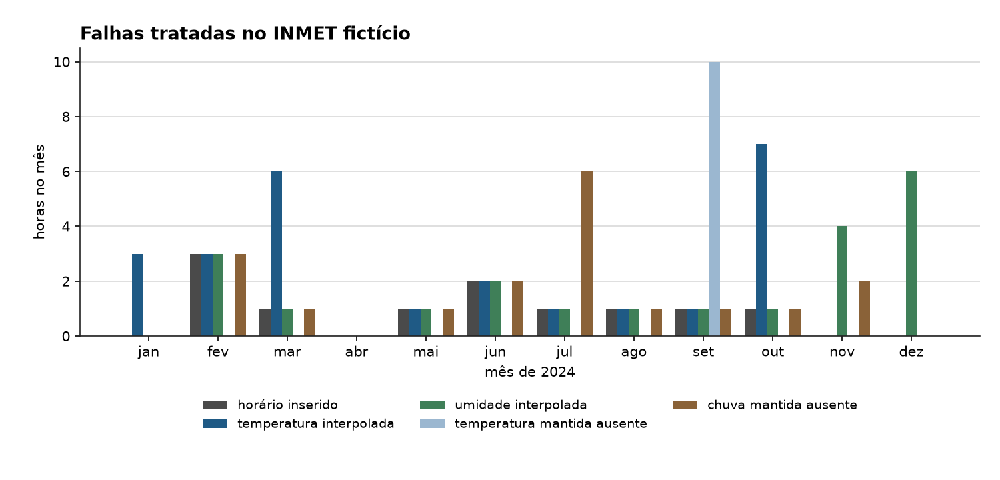

# Pipeline climático antes da modelagem

[](https://github.com/brunomartinsmv/pipeline-climatico-antes-modelagem/actions/workflows/testes.yml)

Exemplo didático, em português, de como preparar dados climáticos antes de qualquer modelo ou machine learning. Um ano de dados **fictícios**, no formato de uma estação do INMET e de um ponto do ERA5, passa por inventário, validação, padronização de unidades, tratamento de lacunas e alinhamento de resoluções até virar uma base processada e rastreável.

O objetivo não é produzir resultado científico. É mostrar o trabalho de bastidor que torna uma análise reproduzível.



## Por que o pipeline vem antes do modelo?

Fontes meteorológicas raramente chegam prontas para análise conjunta. Elas diferem em resolução temporal, unidade, formato, convenção de acumulação e cobertura. Antes de treinar qualquer modelo, é preciso responder:

- De onde veio cada variável e em que unidade?
- A grandeza é instantânea ou acumulada? Em que intervalo?
- Quais horários faltam e o que foi feito com eles?
- O dado bruto foi preservado e a base final pode ser reconstruída?

Um exemplo do que dá errado sem essas perguntas: interpolar para a grade horária a chuva do ERA5, acumulada em 3 horas, triplica o total anual. O [notebook](notebooks/00_visao_geral_pipeline.ipynb) mostra esse erro e a correção.

## Comece aqui

```bash
git clone https://github.com/brunomartinsmv/pipeline-climatico-antes-modelagem.git
cd pipeline-climatico-antes-modelagem
python -m venv .venv
source .venv/bin/activate          # no Windows: .venv\Scripts\activate
python -m pip install -r requirements.txt

python -m pipeline_climatico tudo
```

O último comando inventaria e valida os brutos, gera `data/processed/base_climatica_ficticia_processada.csv` e salva os painéis em `figures/`. Depois, abra o notebook para acompanhar cada etapa:

```bash
jupyter notebook notebooks/00_visao_geral_pipeline.ipynb
```

## Etapas

| Etapa | Comando |
|---|---|
| Inventariar variáveis, tipos e ausências | `python -m pipeline_climatico inventariar` |
| Validar colunas, datas duplicadas e ordem | `python -m pipeline_climatico validar` |
| Padronizar, tratar lacunas e alinhar resoluções | `python -m pipeline_climatico preparar` |
| Gerar painéis mensais | `python -m pipeline_climatico graficos` |
| Recriar os dados fictícios a partir da semente | `python -m pipeline_climatico gerar-dados` |

As regras de cada etapa estão em [decisões metodológicas](docs/decisoes_metodologicas.md). O [controle de variáveis](docs/controle_variaveis.md) descreve cada coluna bruta e processada.



## Estrutura

```text
pipeline_climatico/   código do pipeline, uma etapa por módulo
notebooks/            percurso guiado pelas etapas
data/raw/             CSVs fictícios versionados e imutáveis
data/processed/       base gerada localmente (não versionada)
docs/                 decisões, controle de variáveis e boas práticas
figures/              painéis gerados pelo pipeline
scripts/              auditoria da cópia pública
tests/                testes do pipeline e da publicação
```

## Limites do exemplo

Os dados de `data/raw/` são inventados, como explica o [guia dos dados](data/README.md). Não representam estação, localidade ou reanálise real, e a diferença entre INMET e ERA5 nos gráficos foi definida no gerador. As regras de preenchimento servem para demonstrar o fluxo; em um projeto real, dependeriam da variável, da duração da falha e do objetivo da análise. Não há modelagem, validação científica ou conclusão.

## Contribuição e citação

Para propor mudanças, veja [como contribuir](CONTRIBUTING.md). O [CHANGELOG](CHANGELOG.md) registra as versões. Para citar o material, use os metadados de [CITATION.cff](CITATION.cff).

## Licença

Os textos, o notebook, as figuras e os dados fictícios estão sob [CC BY 4.0](LICENSE): você pode copiar, adaptar e redistribuir, desde que dê o crédito a Bruno Martins e indique as alterações. O código em `pipeline_climatico/`, `scripts/` e `tests/` está sob a [licença MIT](LICENSE-CODE).

INMET e ERA5 são citados apenas como referência de formato. Nenhum dado dessas fontes acompanha o repositório.
